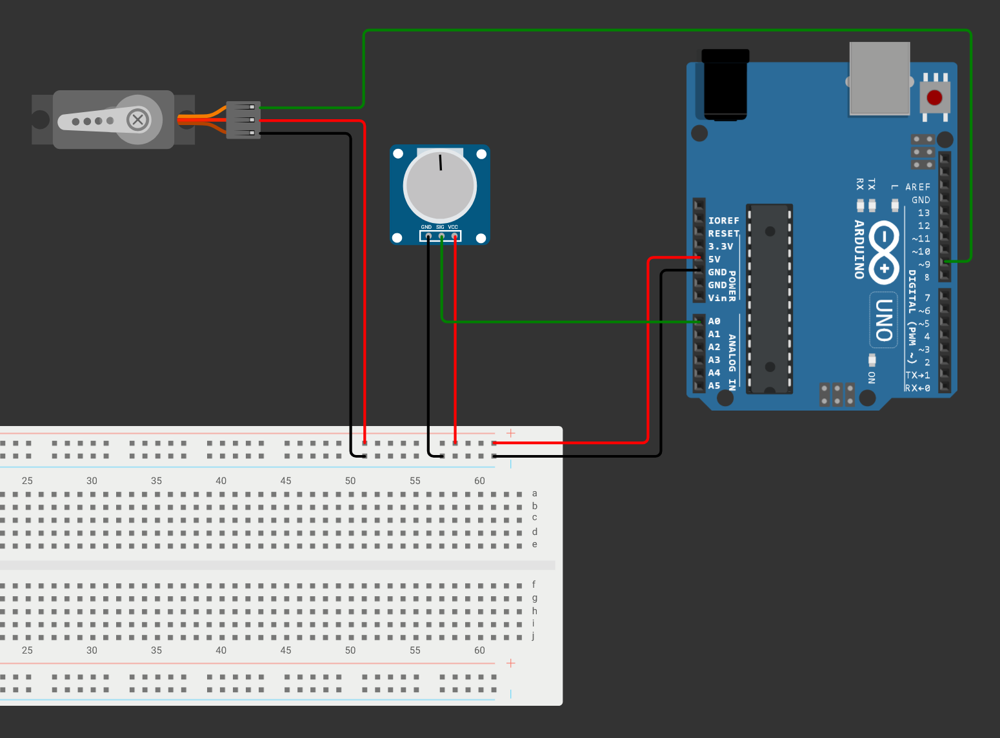

# Heavy Machinery Control Simulation

A Hardware-in-the-Loop (HIL) style simulation built on a single **Arduino Uno** that models the rotational physics and PID control of heavy machinery (such as a turret, radar dish, or aircraft yaw axis). 

A rotary potentiometer serves as the pilot/operator's target heading input, while a PID controller drives a simulated heavy plant with rotational inertia and drag. A servo motor acts as a real-time visual gauge of the machinery's current heading, alongside live telemetry printed to the Serial Monitor/Plotter.

## Features
- **Modular HIL Architecture:** Cleanly separates the **Controller** (`computeController`) from the **Heavy Machinery Plant** (`simulatePlant`), making it straightforward to split onto two separate Arduinos later.
- **Physics-Based Plant Model:** Simulates rotational inertia, friction/drag, torque limits, and mechanical hard stops (`-135°` to `+135°`).
- **PID Control Loop:** Runs at a fixed 50 Hz (`dt = 0.02s`) with anti-windup clamping to smoothly accelerate and brake heavy loads without overshooting.
- **Real-Time Telemetry & Visuals:** Outputs `Target`, `Control`, `Angle`, and `Speed` over Serial (`115200` baud) while mapping the simulated angle onto a 180° servo indicator.

## Hardware & Wiring

### Components
- 1× Arduino Uno
- 1× Rotary Potentiometer (270° sweep)
- 1× Micro Servo Motor
- 1× Breadboard & Jumper Wires

### Pin Connections

| Component | Pin | Arduino Uno Pin | Notes |
| :--- | :--- | :--- | :--- |
| **Potentiometer** | `VCC` | `5V` | Power rail |
| **Potentiometer** | `SIG` | `A0` | Target heading input (`-135°` to `+135°`) |
| **Potentiometer** | `GND` | `GND` | Ground rail |
| **Servo Motor** | `V+` | `5V` | Power rail |
| **Servo Motor** | `PWM` | `D9` | Visual angle indicator (`0°` to `180°`) |
| **Servo Motor** | `GND` | `GND` | Ground rail |

## Design


## Video
<video src="https://github.com/user-attachments/assets/67ec1d0a-c656-4cc0-96ac-4db65fe103fb" controls="controls" style="max-width: 730px;"></video>

## How It Works

1. **Pilot Input (`-135°` to `+135°`):** Reads the analog voltage on `A0` (`0–1023`) and converts it to a target angle across the potentiometer's 270° sweep (`0°` = North, `-135°` = South-West, `+135°` = South-East).
2. **PID Controller (`computeController`):** Compares `targetAngle` with `machine.angle` and computes a normalized actuator command (`-100%` to `+100%`).
3. **Heavy Machinery Plant (`simulatePlant`):** Converts the control percentage into motor torque, subtracts rotational drag, and integrates angular acceleration over `dt` using the moment of inertia (`inertia = 5.0`) to update `speed` and `angle`.
4. **Output & Telemetry:** Maps the machinery's `-135°` to `+135°` position onto the servo's `0°` to `180°` range and prints CSV-formatted telemetry for the Arduino Serial Plotter:
   ```text
   Target:45.00,Control:62.50,Angle:28.40,Speed:34.12
   ```

## Tunable Parameters

You can adjust the feel of the controller and machinery at the top of the sketch:

```cpp
// PID Gains
float Kp = 2.0;   // Proportional turning force
float Ki = 0.05;  // Integral steady-state correction
float Kd = 1.2;   // Derivative braking/damping

// Heavy Machinery Physics
float maxMotorTorque = 150.0; // Max torque at 100% control signal
float inertia = 5.0;          // Mass resistance to turning (higher = heavier)
float friction = 0.8;         // Rotational bearing/air drag
```

## Future Improvements
- Split `computeController()` and `simulatePlant()` across **two separate Arduino boards** communicating over UART/Serial or PWM for full dual-board Hardware-in-the-Loop testing.
- Replace the 180° servo with a stepper motor for a 1:1 270° visual sweep.

## Acknowledgements
Special thanks to [Wokwi](https://wokwi.com) for providing the online circuit simulator used to design and test this project.
